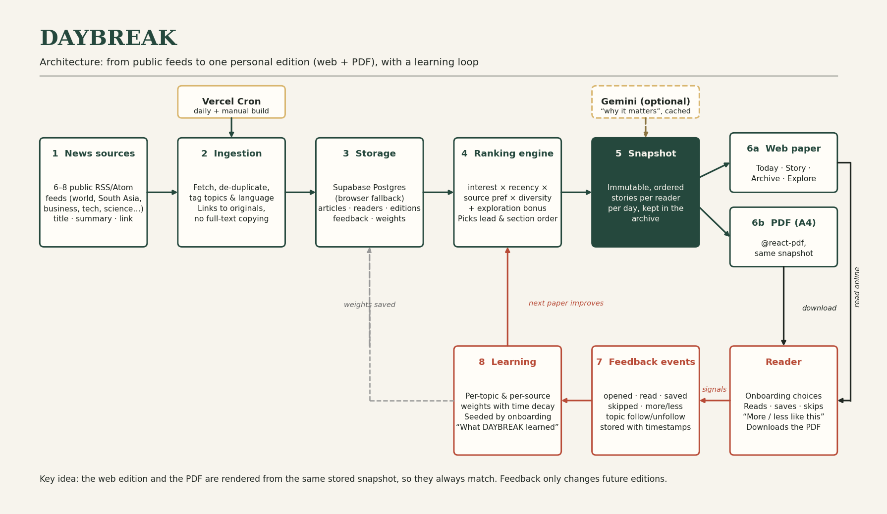
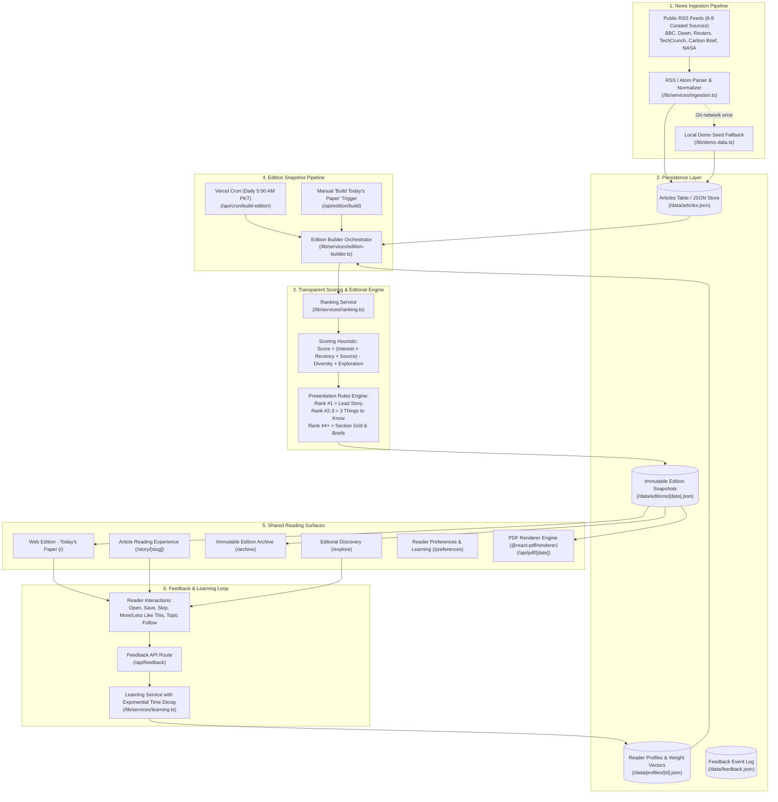

# DAYBREAK Architecture & System Design

> **"A world of news, shaped around you."**  
> NaSCon '26 Hackathon (Eynvision) Entry

---

## 1. System Overview & Architecture Diagram

---

## 2. Core Architectural Pillars

### A. Real Ingestion with Zero-Fail Resilience
- **Public RSS Feeds**: We ingest 8 verified, publicly accessible RSS feeds covering World, Pakistan & South Asia, Business, Technology & AI, Science, Climate, and Sports.
- **Fair Use & Summary-Only**: DAYBREAK strictly extracts titles, summaries, timestamps, author credits, and image URLs. We never scrape or replicate full article text; readers are directed to original publishers with attribution.
- **Dual-Mode Persistence**: Storage operations pass through an abstract interface (`/lib/services/storage.ts`). The application runs out of the box using local JSON snapshots, and seamlessly integrates Supabase Postgres when connection strings are supplied.

### B. Transparent, Explainable Ranking Engine
Unlike black-box algorithms, DAYBREAK uses an explainable mathematical heuristic:

$$\text{Total Score} = (\text{Interest Weight} \times \text{Recency Score} \times \text{Source Preference}) - \text{Diversity Penalty} + \text{Exploration Bonus}$$

1. **Interest Weight ($0.0 \dots 1.0$)**: Stated topics initialized during onboarding, augmented by learned affinity weights.
2. **Recency Decay**: Exponential half-life decay ($\lambda = \frac{\ln(2)}{12\text{ hours}}$). Articles older than 24 hours decline gracefully.
3. **Source Preference ($0.0 \dots 1.0$)**: Preferred publishers receive positive scoring multiplier.
4. **Diversity Penalty ($0.3$)**: Applied once a single category claims $\ge 3$ slots, preventing mono-topic clutter.
5. **Exploration Bonus ($+0.1$)**: Awarded to topics outside the reader's current bubble to encourage broad worldview discovery.

### C. Presentation & Editorial Layout Rules
The ranking engine doesn't just sort stories; it designs the newspaper:
- **Rank #1 $\rightarrow$ Lead Story**: Prominently featured with a full-width hero image, category kicker, and detailed summary.
- **Ranks #2–3 $\rightarrow$ "3 Things to Know"**: Executive summary briefing above the fold.
- **Ranks #4+ $\rightarrow$ Multi-Column Sections**: Dynamically sized into *Featured* (2 columns), *Standard* (3 columns), or *Brief* (4 columns) according to priority.

### D. The Learning Feedback Loop
- User events (`saved`, `opened`, `skipped`, `more_like_this`, `less_like_this`, `topic_follow`, `topic_unfollow`) record instant updates in `/lib/services/learning.ts`.
- **Time Decay**: Inactivity causes learned weights to regress toward neutral ($0.5$) with a 7-day half-life, ensuring the paper reflects current, not stale, interests.
- **Explainability Panel**: The `/preferences` page exposes a real-time dashboard displaying high-affinity and deprioritized topics.

### E. Single Source of Truth for Web & PDF
The web edition (`/`) and the downloadable print edition (`/api/pdf/[date]`) render from the exact same immutable `Edition` JSON snapshot. Page breaks in the PDF never sever headlines from opening paragraphs (`wrap={false}`).
